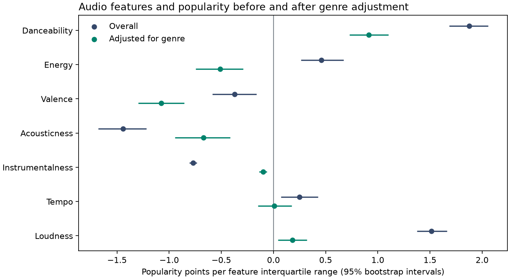
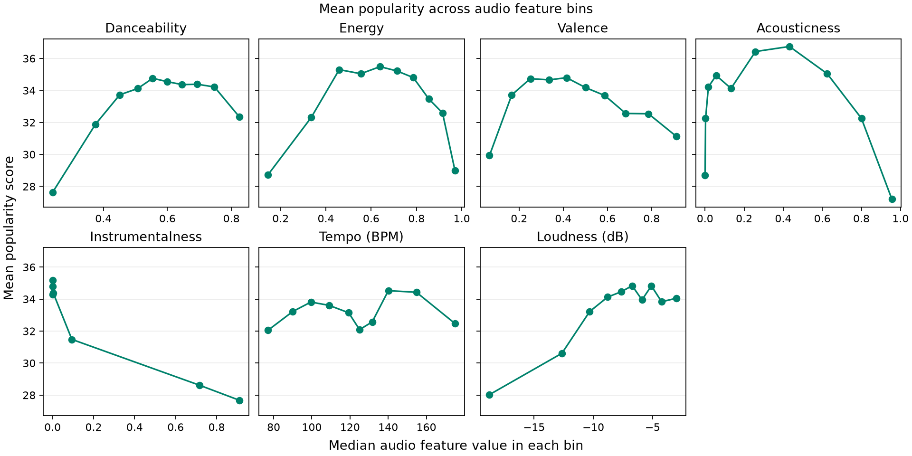
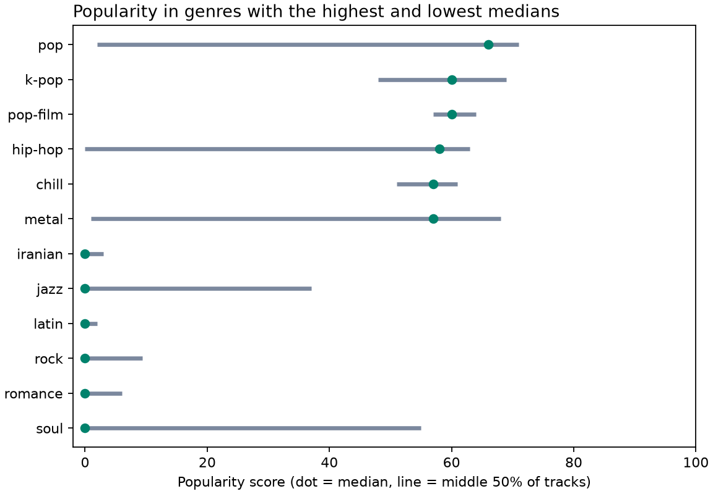

# Audio features and track popularity

Across 89,583 unique tracks, genre adjustment reduced several associations between audio features and Spotify popularity. Danceability's estimate fell from **+1.88 to +0.91 points** per interquartile-range increase. Loudness fell from **+1.52 to +0.18 points**, and energy's estimated linear association reversed direction. All seven adjusted point estimates were within **1.08 points** on the 0–100 popularity scale.



**How to read it.** Dots mark the estimated change in popularity per feature interquartile range, and lines show 95% bootstrap intervals. Loudness shifts sharply toward zero after genre adjustment. Energy crosses to the other side of zero, while the adjusted tempo interval spans zero.

## Data and process

1. **Read the canonical catalog.** Load tracks, genre memberships, and snapshot metadata from PostgreSQL in one read-only transaction. The analysis included 89,583 tracks, 114 genres, and 113,392 track–genre memberships.
2. **Verify the source.** Match the raw file's SHA-256 hash to the loaded snapshot. Reapply the validation rules to the raw observations to recover the 720 track IDs with conflicting popularity values. The canonical track score is the median of the distinct valid source scores for that ID. [Data contract](data_contract.md)
3. **Summarize popularity.** Use one row per track for Spearman rank correlations and plots of mean popularity across audio feature bins. Use one row per track and genre for genre counts, popularity quartiles, and median audio features.
4. **Compare effect sizes.** Fit a separate linear regression for each audio feature. The overall estimate uses the unique tracks. The adjusted estimate compares tracks within genres using genre-specific intercepts. A track with *k* genre memberships contributes weight *1/k* to each genre, so its total weight is one. Effects are expressed in popularity points per feature interquartile range, the distance from the 25th to the 75th percentile in the full catalog.
5. **Estimate uncertainty and check sensitivity.** Draw 1,000 bootstrap samples of unique track IDs with replacement using seed 42. Each resampled track carries all its genre memberships. Refit both slopes in every sample and take the 2.5th and 97.5th percentiles of the estimates. The paired differences use the same draw for both slopes. Refit the point estimates after excluding the 720 conflicting tracks and keep the full-catalog feature scales for comparison.

## Audio associations

Spearman's ρ measures how consistently the popularity rank rises or falls as the feature rank increases. The linear estimates describe the average change in fitted popularity across one feature interquartile range. Parentheses show pointwise 95% bootstrap intervals.

| Audio feature | Overall Spearman ρ | Overall popularity points | Genre-adjusted popularity points |
|---|---:|---:|---:|
| Danceability | +0.056 | +1.88 (+1.68 to +2.06) | +0.91 (+0.73 to +1.10) |
| Energy | −0.015 | +0.46 (+0.26 to +0.67) | −0.51 (−0.75 to −0.29) |
| Valence | −0.010 | −0.37 (−0.58 to −0.16) | −1.08 (−1.29 to −0.86) |
| Acousticness | +0.010 | −1.44 (−1.68 to −1.22) | −0.67 (−0.94 to −0.41) |
| Instrumentalness | −0.125 | −0.77 (−0.81 to −0.73) | −0.10 (−0.14 to −0.06) |
| Tempo | +0.009 | +0.25 (+0.07 to +0.43) | +0.01 (−0.15 to +0.17) |
| Loudness | +0.068 | +1.52 (+1.38 to +1.66) | +0.18 (+0.04 to +0.32) |

- **Danceability** retained a positive association. A 0.242 increase on its 0–1 scale corresponded to about 0.91 popularity points after genre adjustment.
- **Energy** illustrates why the plots matter. Mean popularity was about 29 points in both the lowest and highest energy bins and reached about 35.5 in a middle bin. The overall rank correlation was close to zero. The fitted line summarizes an average slope across that curved pattern.
- **Instrumentalness** had the largest absolute rank correlation, at 0.125. Its genre-adjusted slope was close to zero over its interquartile range. The binned chart shows the decline at higher instrumentalness values.
- **Conflicting scores** had little influence on these estimates. Excluding the 720 tracks changed the overall or adjusted slope by at most **0.034 popularity points** per full-catalog feature interquartile range.



**What stands out.** Energy rises from roughly 29 popularity points in the lowest bin to about 35.5 in a middle bin and returns to about 29 at the high end. The pooled relationship is curved, so a single slope summarizes it only partially. Tied feature values can make the bins unequal in size.

## Genre distributions

Pop had a median popularity of **66**, with the middle half of scores spread from **2 to 71** across 993 tracks. Pop-film had a median of **60**, with the middle half from **57 to 64** across 999 tracks. Similar medians can conceal very different distributions. The chart shows six genres from each end of the median ranking, and the CSV contains all 114 genres and their median audio features. [Full genre profiles](../reports/statistics/genre_profiles.csv)



**How to read it.** Each dot is the genre median, and the line spans the middle half of track scores. Pop has a median of 66 and a wide 2–71 range. Pop-film has a similar median of 60, with a much narrower 57–64 range. The lines describe track variation within each genre.

## Interpretation and limitations

- The estimates describe associations in this dataset snapshot. Each regression adjusts for genre alone. Artist, release history, promotion, playlists, and relationships among audio features can also affect the patterns.
- The adjusted estimate averages a common linear slope across genres. Individual genres may have different slopes and some relationships are curved.
- The bootstrap accounts for repeated genre memberships of the same track. Tracks by the same artist may also be related, and the intervals do not model that dependence. Intervals are pointwise and are intended for exploratory comparisons across the seven features.
- Genre memberships overlap, and the source catalog's genre mix and score distribution constrain generalization. The catalog validation rules also exclude tracks with invalid or missing required values.

## Reproduce the analysis

With the catalog loaded and `SPOTIFY_DATABASE_URL` set, run from the repository root. [PostgreSQL setup and loading](postgresql.md)

```powershell
.\.venv\Scripts\python.exe src\spotify_statistical_analysis.py
```

The run exports the effect estimates (including paired differences and the sensitivity analysis), genre profiles, audio-bin trends, three charts, and a manifest with the dataset fingerprint, seed, and resample count. [Effect estimates](../reports/statistics/audio_associations.csv) · [Binned trends](../reports/statistics/audio_trends.csv) · [Run manifest](../reports/statistics/manifest.json)
